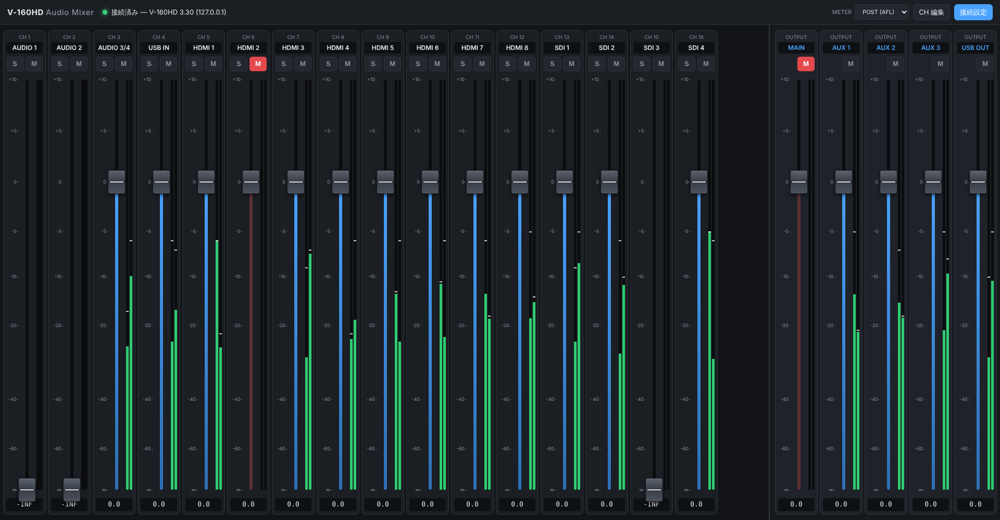

# V-160HD Audio Mixer

Roland V-160HD のオーディオミキサーを PC から操作するソフトです。LAN 経由で動きます。



- **16ch の入力フェーダー**: 各チャンネルに 21 系統の入力（AUDIO 1, 2, 3/4, USB, Bluetooth, HDMI 1–8, SDI 1–8）から好きなものを割り当てられます
- 各チャンネルに **MUTE / SOLO** と **L/R レベルメーター**（ピークホールド付き）
- **出力セクション**: MAIN, AUX 1–3, USB OUT のフェーダーと MUTE
- 本体側で操作した内容も約 1 秒ごとに画面へ反映されます
- 同じ LAN 上の iPad などのブラウザからも同時に操作できます

```
[ブラウザ画面] ⇄ WebSocket ⇄ [このソフト (Node.js)] ⇄ TCP 8023 ⇄ [V-160HD]
```

## 必要なもの

- Node.js 18 以降（https://nodejs.org/）
- V-160HD と PC を同じネットワークにつなぐこと（V-160HD 背面の **LAN CONTROL** 端子を使います）

## V-160HD 側の設定

1. [MENU] → **LAN CONTROL** → CONFIGURE を「USING DHCP」か「MANUAL」に設定し、IP アドレスを確認します
2. 同じメニューで **NETWORK PASSWORD**（4 桁）を設定します

## 起動

| OS | 方法 |
|---|---|
| macOS | `start.command` をダブルクリック |
| Windows | `start.bat` をダブルクリック |
| ターミナル | `npm install` のあと `npm start` |

ブラウザで http://localhost:8160/ が開きます。右上の「**接続設定**」から V-160HD の IP アドレスとパスワードを入力してください。設定は `config.json` に保存され、次回からは自動で接続します。

起動するとターミナルに「同じLANの端末: http://192.168.x.x:8160/」と表示されます。iPad などで開けば、そこからも操作できます。

### 実機なしで試す（デモ）

```
npm install
npm run demo        # または demo.command をダブルクリック
```

V-160HD のシミュレーター（`mock/mock-v160hd.js`）が起動し、そこに接続します。

## 操作

| 操作 | 内容 |
|---|---|
| フェーダーを上下にドラッグ | レベル変更（-INF, -80.0 〜 +10.0 dB）。触った位置にジャンプしないので、本番中に誤ってタップしても安全です |
| Shift + ドラッグ | 微調整 |
| マウスホイール | 0.5 dB ずつ（Shift で 0.1 dB） |
| フェーダーをダブルクリック | 0 dB に戻す |
| dB 表示をダブルクリック | 数値を直接入力（例: `-6`, `3.5`, `-inf`） |
| ↑ / ↓、PageUp / PageDown | フォーカス中のフェーダーを 0.5 dB / 5 dB 動かす |
| M キー | フォーカス中チャンネルのミュート切り替え |
| 「CH 編集」 | 各 CH の入力ソースと表示名を変更（自動保存） |
| METER | メーターのポイントを POST（フェーダー後, AFL）か PRE（フェーダー前, PFL）に切り替え |

## 設定ファイル（config.json）

初回起動時に作られます。主な項目は次のとおりです。

| キー | 既定値 | 説明 |
|---|---|---|
| `host` / `port` / `password` | – / 8023 / – | V-160HD の接続先 |
| `httpPort` | 8160 | ブラウザ画面のポート |
| `pollIntervalMs` | 1000 | 本体の状態を読み直す間隔 |
| `meterIntervalMs` | 100 | メーターを更新する間隔 |
| `strips` | – | 16ch の割り当て（`source`）と表示名（`name`） |

コマンドライン引数で一時的に上書きできます（例: `node server.js --host 192.168.0.50 --password 1234`）。

## 使用しているコマンド

Roland「LAN/RS-232 Basic Control Commands」と「V-160HD Remote Control Guide（LAN/RS-232 Command Reference）」に従っています。

| 用途 | コマンド |
|---|---|
| 入力レベル | `IAL:a,b;` / `QIAL:a;`（b は 0.1 dB 単位: -800〜100, または `-INF`） |
| 入力ミュート / ソロ | `IAM:a,ON;` / `IAS:a,ON;` / `QIAM` / `QIAS` |
| 出力レベル / ミュート | `OAL:a,b;` / `OAM:a,ON;` / `QOAL` / `QOAM`（a: MAIN, AUX1–3, USB） |
| メーター | `MTRLV:AFL;`（54 値）, `MTRCH:n;`（並び順を取得） |
| 接続確認 | `VER;` |

コマンドは 1 つずつ送り、`ACK;` か `ERR:n;` が返ってから次を送ります。フェーダーを速く動かしたときは、まだ送っていない古い値を捨てて最新の値だけを送ります。

## 注意

- 本体の LAN CONTROL に同時に接続できるクライアントの数には限りがあると考えられます。ほかの制御ソフト（V-160HD RCS や Companion など）と同時に使う場合は注意してください。
- 接続直後にパスワード入力を求められた場合は、自動で入力します。メーカー資料には接続直後のパスワードのやり取りが詳しく書かれていないため、実機でうまく接続できないときはターミナルの表示を確認してください。
